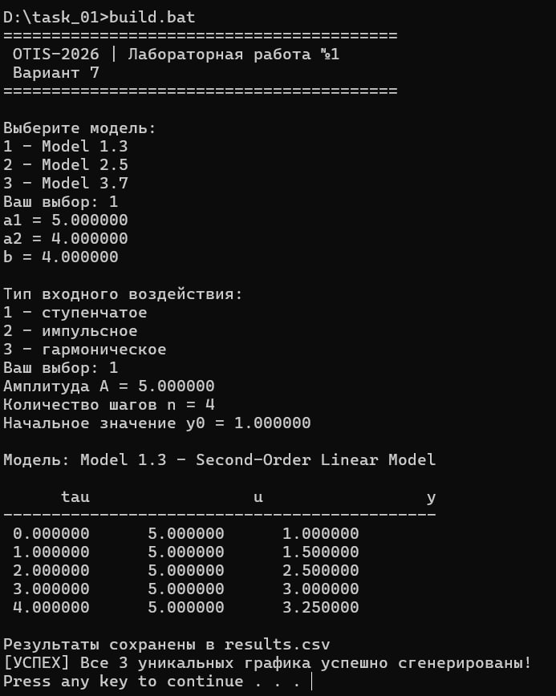
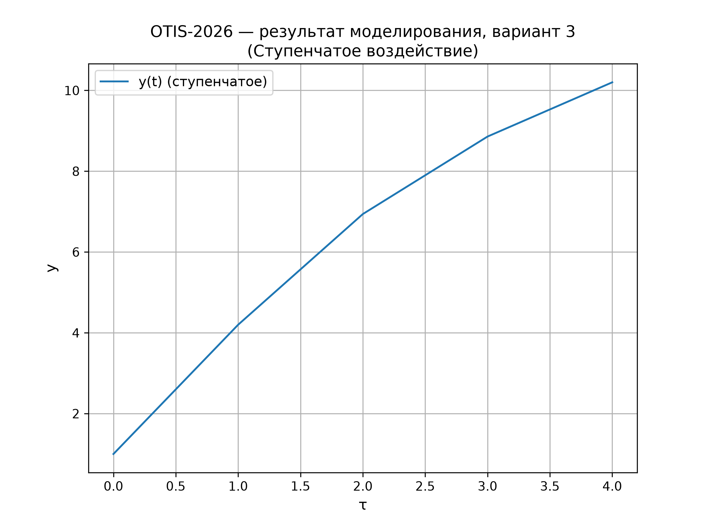
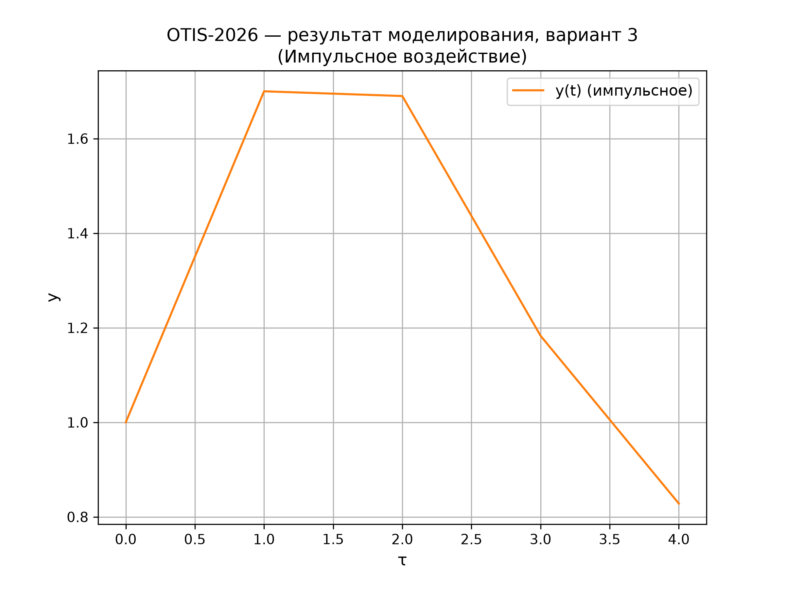
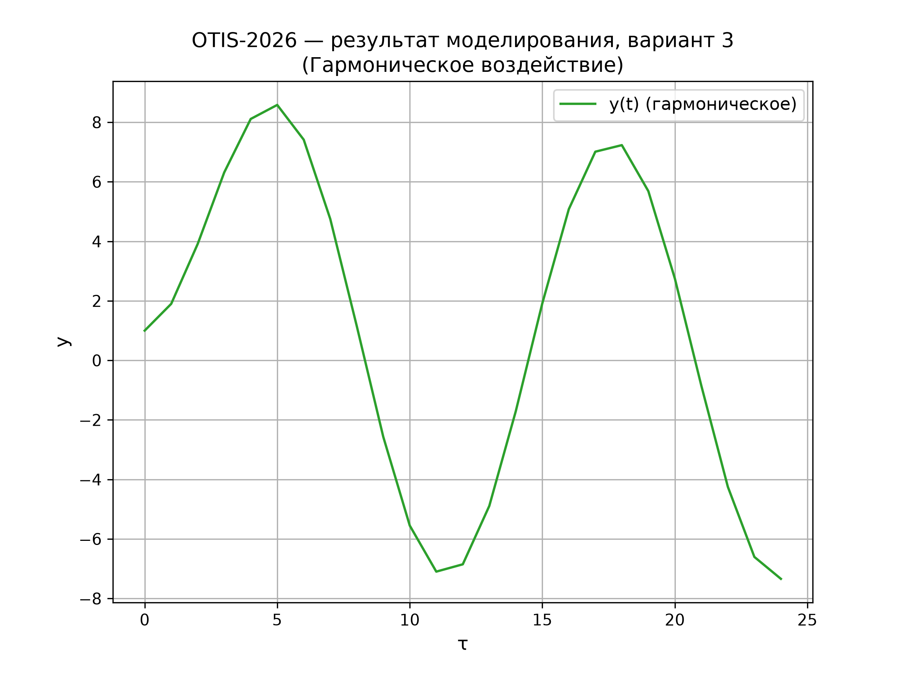

<p align="center"> Министерство образования Республики Беларусь</p>
<p align="center">Учреждение образования</p>
<p align="center">“Брестский Государственный технический университет”</p>
<p align="center">Кафедра ИИТ</p>

<br><br><br><br><br><br><br>

<p align="center">Лабораторная работа №1</p>
<p align="center">По дисциплине “Общая теория интеллектуальных систем”</p>
<p align="center">Тема: “Моделирования температуры объекта”</p>

<br><br><br><br><br>

<p align="right">Выполнил:</p>
<p align="right">Студент 2 курса</p>
<p align="right">Группы ИИ-30</p>
<p align="right">Кулешов Н.С.</p>
<p align="right">Проверил:</p>
<p align="right">Дворанинович Д. А.</p>

<br><br><br><br><br>
<p align="center">Брест 2026</p>

---

## Вариант 7
- Линейная модель: **Model 1.7**
- Нелинейная модель: **Model 2.9**
- Дифференциальное уравнение: **Model 3.1**

## Реализованные модели

### Model 1.7
`y_{τ+1} = a·y_τ + b_1·u_τ + b_2·u_{τ-1} + b_3·u_{τ-2}`

### Model 2.9
`y_{τ+1} = a·y_τ + b·√|u_τ| · sign(u_τ)`

### Model 3.1
`dy/dt = -a · y`

## Входные воздействия
1. Ступенчатое: `u(t) = A`
2. Импульсное: `u(0) = A`, `u(t > 0) = 0`
3. Гармоническое: `u(t) = A*sin(t)`

## ООП
Создан абстрактный базовый класс `Model` с виртуальным методом `calculateNext()`.
От него наследуются:
- `Model1_7`
- `Model2_9`
- `Model3_1`

## Результат
Программа:
- позволяет выбрать модель;
- принимает заданные пользователем коэффициенты;
- позволяет выбрать тип входного воздействия;
- позволяет задать количество шагов симуляции `n`;
- выводит результаты расчетов в компактном табличном виде в консоль;
- автоматически сохраняет результаты в файл данных для построения графиков;
- строит графики переходных процессов с помощью Python и библиотеки Matplotlib.

## Пример работы программы

### Сборка
На Windows через `build.bat`:

```bat
@echo off
setlocal

if not exist "%~dp0CMakeLists.txt" (
    echo ERROR CMakeLists not found in this folder
    pause
    exit /b 1
)

cd /d "%~dp0"

echo STARTING BUILD PROCESS

echo STAGE 1 Configuration
cmake -S . -B build
if errorlevel 1 goto error

echo STAGE 2 Compilation
cmake --build build --config Release
if errorlevel 1 goto error

echo SUCCESS Build completed successfully
echo Executable files are in build Release folder
pause
goto end

:error
echo ERROR Build failed
pause
exit /b 1

:end
endlocal
```

После сборки запускать исполняемый файл из каталога `build`.

### Демонстрация исполняемого файла otis_task_01.exe:



При запуске исполняемого файла мы получаем результат файл.csv, после чего автоматически запускается plot_generator.py для визуализации ответа:

## Демострация ступенчатого воздействия

## Демострация импульсного воздействия

## Демострация гармонического воздействия



```mermaid
classDiagram
    class Model {
        <<abstract>>
        +calculateNext(y, yPrev, u, dt) double
        +getName() const char*
    }
    class Model1_7 {
        -a double
        -b1 double
        -b2 double
        -b3 double
        +calculateNext(...) double
    }
    class Model2_9 {
        -a double
        -b double
        +calculateNext(...) double
        -sign(x) double
    }
    class Model3_1 {
        -a double
        +calculateNext(...) double
    }
    Model <|-- Model1_7
    Model <|-- Model2_9
    Model <|-- Model3_1